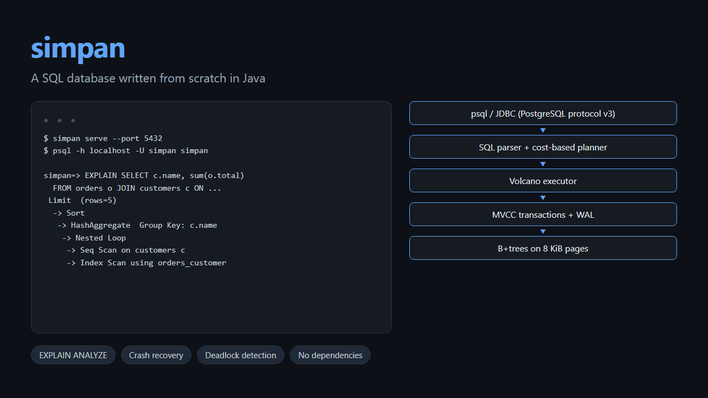

# Simpan

**A SQL database written from scratch in Java.** It has B+tree indexes over slotted pages and a buffer pool, MVCC transactions, a write-ahead log with crash recovery, and a cost-based query planner with `EXPLAIN ANALYZE`. It speaks the PostgreSQL wire protocol, so `psql` and the official PostgreSQL JDBC driver can connect to it. *Simpan* is Malay for "keep" or "store".

<p align="center">
  
</p>

[](https://github.com/Tendo505/simpan/actions/workflows/ci.yml)
Java 21 · no runtime dependencies · about 10,000 lines, plus 1,500 of tests

```
$ simpan serve --port 5432
Simpan is listening on localhost:5432 (data in ./simpan-data)

$ psql -h localhost -U simpan simpan
simpan=> CREATE TABLE orders (id int PRIMARY KEY, customer_id int, total double precision, status text);
simpan=> CREATE INDEX orders_customer ON orders (customer_id);
simpan=> EXPLAIN SELECT c.name, count(*), sum(o.total)
           FROM orders o JOIN customers c ON c.id = o.customer_id
          WHERE c.country = 'MY' AND o.status = 'paid'
          GROUP BY c.name ORDER BY 3 DESC LIMIT 5;
                                   QUERY PLAN
--------------------------------------------------------------------------------
 Limit  (rows=5)
   ->  Sort  (rows=2000)
         Sort Key: sum(o.total) DESC
         ->  HashAggregate  (rows=2000)
               Group Key: c.name
               ->  Nested Loop  (rows=4167)
                     ->  Seq Scan on customers c  (rows=500)
                           Filter: (c.country = 'MY')
                     ->  Index Scan using orders_customer on orders o  (rows=8)
                           Index Cond: (customer_id = c.id)
                           Filter: (o.status = 'paid')
```

The planner chose that order and those joins itself. It filtered customers first, then probed the orders index once for each customer, because the statistics said that's cheaper than scanning 50,000 orders.

## How it's built

```
 psql / JDBC ──► server/       PostgreSQL protocol v3: simple and extended query, text and binary values
                 engine/       Session (transactions, DML, DDL) · Database (recovery, checkpoints) · Table (MVCC)
                 sql/          lexer, recursive-descent parser, Pratt expressions with PostgreSQL's precedence
                 plan/         binder (names, types) · planner (pushdown, index choice, join order)
                 exec/         Volcano operators: scans, hash/index/nested-loop joins, aggregation, sort, set ops
                 tx/           transaction ids, commit log, snapshots, row-lock waits, deadlock detection
                 storage/      8 KiB pages with checksums · buffer pool · heap files · B+trees
                 wal/          write-ahead log: group commit, full-page images, recovery
```

### Storage

Tables are heap files of **slotted pages**. Every page carries a CRC32C checksum, so a page torn by a crash is detected rather than read as garbage. Pages live in a fixed-size **buffer pool** with clock eviction. Indexes are **B+trees** whose keys are encoded so that comparing their bytes gives SQL order: sign-flipped integers, bit-twiddled doubles, escaped UTF-8 text, and NULLs last. Each index entry ends with the row's location, which makes duplicate keys unique entries, and turns a lookup into a range scan over a key prefix.

### Durability: write-ahead log and recovery

Every heap change is logged before its page can reach disk (the WAL rule, enforced by the buffer pool). The first change to a page after a checkpoint logs a **full image** of the page. That's PostgreSQL's defence against torn writes. **Commits** wait for the fsync, and commits that arrive during one fsync share the next, so a single fsync covers many commits (group commit). **Checkpoints** flush everything, write the schema and commit log, and start a new log segment.

Recovery is **redo-only**. Old row versions are never overwritten (that's what MVCC is for), so an unfinished transaction's work just stays invisible once it's marked aborted. Nothing needs undoing. Indexes are derived data, so after a crash they're rebuilt from the heap instead of being logged.

### Transactions: MVCC

Each row version records the transaction that created it (`xmin`) and the one that deleted or replaced it (`xmax`). A **snapshot** decides which versions a statement can see. Readers never block writers, and writers never block readers.

* **READ COMMITTED** (the default) takes a new snapshot per statement. **REPEATABLE READ** keeps one snapshot for the whole transaction (snapshot isolation, like PostgreSQL's).
* An UPDATE or DELETE claims a row by setting its `xmax`; a second writer waits for the first to finish. Under READ COMMITTED, if the first one committed, the waiter follows the chain to the row's newest version, re-checks its WHERE clause, and updates that version (as PostgreSQL does). So eight threads running `SET n = n + 1` never lose an increment. Under REPEATABLE READ, the waiter gets a serialization failure (`40001`) instead.
* **Deadlocks** are found by following the wait-for chain, and one transaction gets `40P01`.
* A **unique index** checks for conflicts and inserts the entry in one step, inside the tree, so two concurrent inserts of the same key can't both get through. If the other insert hasn't committed yet, this one waits to see whether it does.
* **VACUUM** removes versions that no snapshot can see any more, then rebuilds the table's indexes.

### Query planning

* Conditions are pushed down to the table they mention. An index serves equalities, ranges and `IN` lists on its leading columns. A fractional bound on an integer column is rounded the right way: `id > 2.5` scans from 3.
* Inner joins are flattened, and the **join order is chosen by dynamic programming** over subsets of the inputs, costed by estimated row counts. ANALYZE gathers the statistics behind those estimates. For each join the planner picks a **hash join**, an **index nested-loop join**, or a nested loop.
* Outer joins (LEFT, RIGHT, FULL), GROUP BY / HAVING, DISTINCT, ORDER BY (with PostgreSQL's rules for output names and ordinals), LIMIT / OFFSET, UNION / INTERSECT / EXCEPT (with or without ALL), uncorrelated subqueries (`IN`, `EXISTS`, scalar), CASE, casts, and around 40 scalar functions.
* `EXPLAIN ANALYZE` runs the query and shows the actual rows and time for each node.

## Tested against a reference database, real crashes, and real clients

`./gradlew test` (CI runs it on every push):

| Test | What it proves |
| --- | --- |
| **Differential fuzzing** | 3,000 random queries over random schemas and data, each run on Simpan and on [H2](https://h2database.com) in PostgreSQL mode, must return the same rows. They cover joins, three-valued logic with NULLs everywhere, subqueries, grouping, DISTINCT, set operations and ORDER BY + LIMIT. Random indexes make the planner use index scans and index joins too. |
| **kill -9 crash recovery** | A child process moves money between accounts in transactions and is killed at a random moment, 8 times over. After each restart: every transaction it acknowledged is there, none of the rolled-back ones are, the money adds up, the balances match the ledger exactly, and every index agrees with its table. |
| **Isolation** | Dirty reads don't happen; READ COMMITTED vs REPEATABLE READ visibility; no lost updates under concurrency; REPEATABLE READ refuses to overwrite a concurrent update; write skew is allowed (as in PostgreSQL); deadlocks are detected; a unique-key insert waits for the other inserter's outcome; VACUUM keeps versions an open snapshot still needs. |
| **JDBC** | The official PostgreSQL driver: statements, server-side prepared statements with binary values, NULLs, errors and recovery after them, transactions. |
| **Storage** | The B+tree against a sorted-set model through 30,000 inserts with a 16-page buffer pool, scans while pages split underneath them, key encoding order (including surrogate pairs and NUL bytes), and torn-page detection. |
| **SQL** | Behaviour end to end, plus the cases H2 can't check: FULL JOIN and INTERSECT/EXCEPT ALL, against answers worked out by hand. |
| **Regressions** | 18 tests for the 26 bugs a multi-agent code review found and reproduced (all fixed). They include JDBC binary parameters decoded with the wrong types, a subquery in `UPDATE ... SET` seeing the statement's own changes, `CREATE UNIQUE INDEX` missing an uncommitted duplicate, LIKE patterns that backtracked for minutes, and batches that weren't all-or-nothing. |

The fuzzer earned its place early. It found that `x NOT IN (subquery)` returned NULL instead of TRUE when the subquery is empty and `x` is NULL. SQL says IN over an empty set is false whatever the operand is.

## Benchmark

On a Windows 11 laptop with JDK 25, `simpan bench 200000`:

| Workload | Time | Rate |
| --- | ---: | ---: |
| Load 200,000 rows (500-row INSERTs, each committed and fsynced) | 1.81 s | 110,707 rows/s |
| Build a secondary index, then ANALYZE | 348 ms | 575,534 rows/s |
| Point lookups by primary key (p50 8.5 us, p99 96.8 us; parse + plan + run each) | 957 ms | 52,227 queries/s |
| Index range scans (2,000 rows each) | 215 ms | 929 queries/s |
| Full scan + GROUP BY over 200,000 rows | 41 ms | 4,865,399 rows/s |
| Concurrent transfers: 8 threads, 40 hot accounts (7 deadlocks retried; 4000 commits in 1487 fsyncs) | 2.85 s | 1,402 txn/s |
| Hash join + GROUP BY of transfers with accounts | 135 ms | 29,542 rows/s |

`simpan bench` checks itself as it goes: after the concurrent transfers, the total balance must be unchanged to the sen, and every transfer must be recorded once.

## Run it

```bash
./gradlew installDist
build/install/simpan/bin/simpan shell                # interactive SQL, with \d and \timing
build/install/simpan/bin/simpan serve --port 5432    # then: psql -h localhost -U simpan simpan
build/install/simpan/bin/simpan bench 200000         # the benchmark above
```

From Java, use the PostgreSQL driver: `jdbc:postgresql://localhost:5432/simpan` (any user name; there's no password).

## What it doesn't do (yet)

* **Correlated subqueries** (write a JOIN), window functions, CTEs, ALTER TABLE, foreign keys, and CHECK constraints.
* **SERIALIZABLE.** REPEATABLE READ gives snapshot isolation, which allows write skew, as PostgreSQL's REPEATABLE READ does.
* **Schema changes can't run inside a transaction block.** They take effect immediately and are logged durably, but they can't be rolled back.
* **psql's `\d` commands**, which query PostgreSQL's system catalogs. Use the shell's `\d` instead. There's also no authentication or TLS.
* **Types:** bigint, double precision, text and boolean. INTEGER and VARCHAR map onto those. Decimal literals are double precision, and text compares by code point (PostgreSQL's "C" collation).
* **Sorts, hash joins and aggregation run in memory.** An update writes a new version into every index (there's no HOT), and index entries for dead rows go away only at VACUUM.

MIT License
